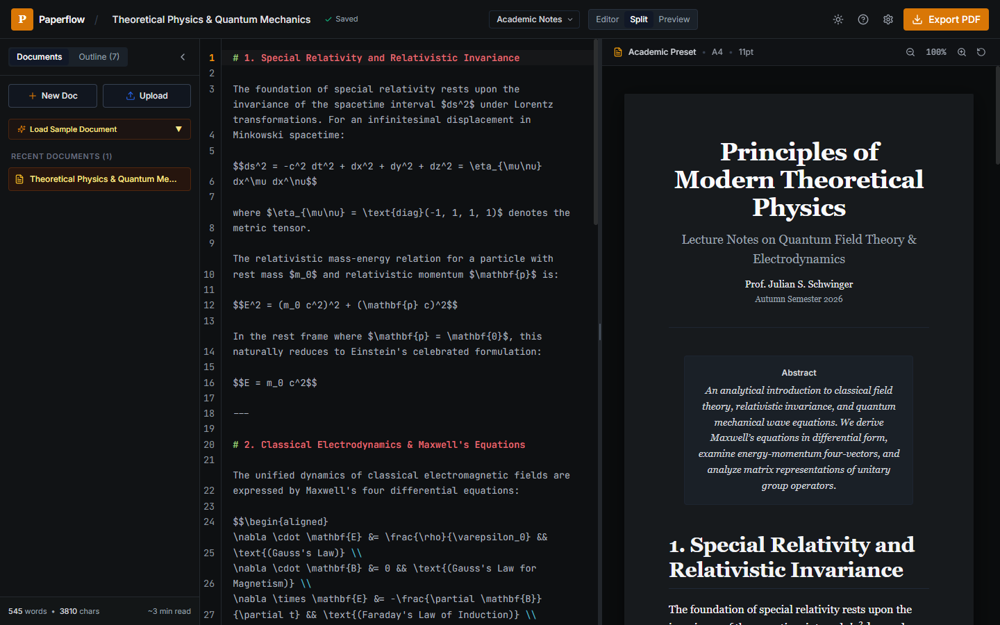
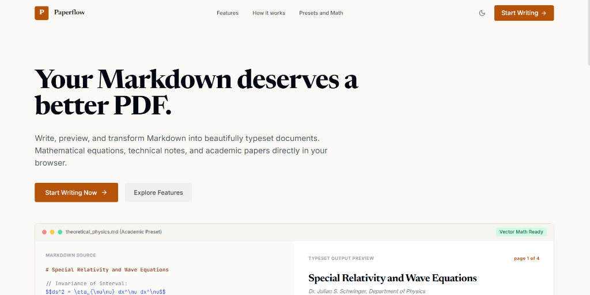
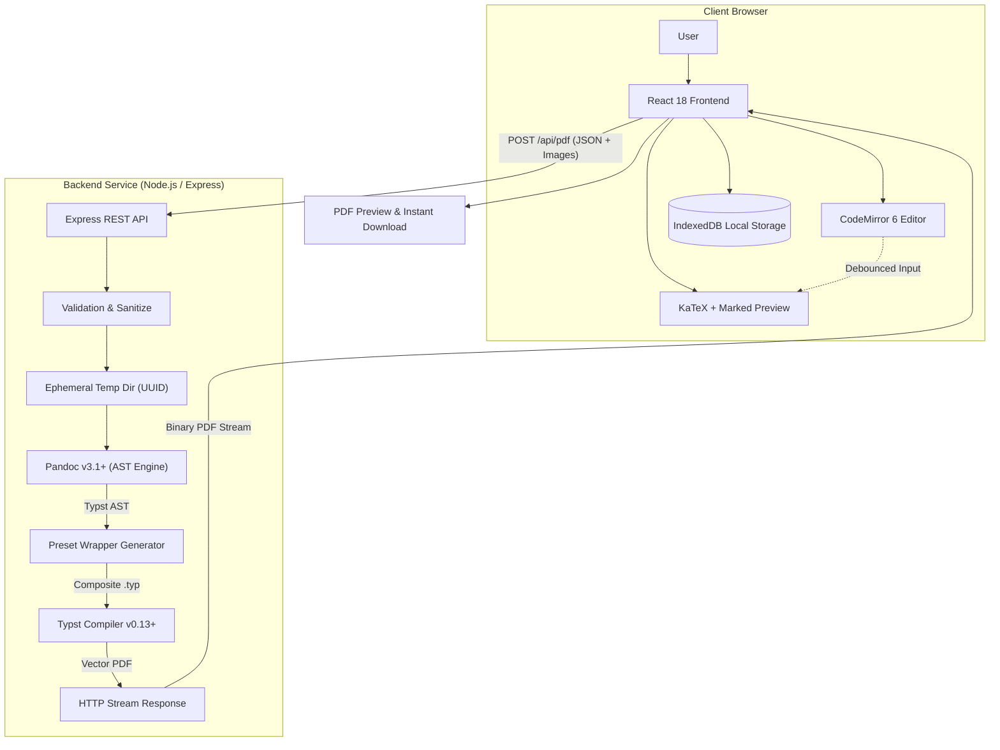
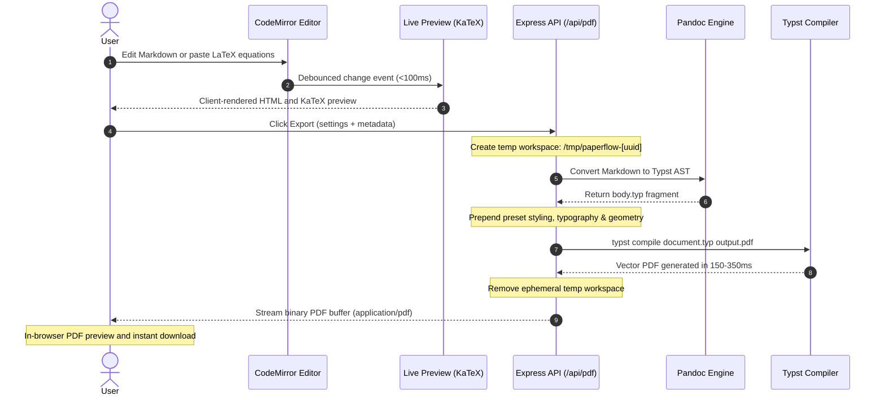
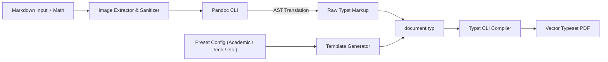

<div align="center">

# Paperflow

**From Markdown to beautifully typeset documents.**

A modern, high-performance Markdown editor and vector PDF publishing tool with first-class LaTeX mathematical typesetting.

[](https://paperflow.reck98.in/)
[](LICENSE)
[](https://www.typescriptlang.org/)
[](https://react.dev/)
[](https://typst.app/)
[](docker-compose.yml)
[](https://github.com/reck98/PaperFlow/stargazers)
[](https://github.com/reck98/PaperFlow/issues)
[](https://github.com/reck98/PaperFlow/commits/main)

<p align="center">
  <a href="https://paperflow.reck98.in/"><strong>🌐 Try the Live Demo at paperflow.reck98.in &rarr;</strong></a>
</p>

</div>

---

## Table of Contents

- [Overview](#overview)
- [Live Demo](#live-demo)
- [Features](#features)
- [Screenshots](#screenshots)
- [Architecture](#architecture)
- [Application Flow](#application-flow)
- [Tech Stack](#tech-stack)
- [Project Structure](#project-structure)
- [Prerequisites](#prerequisites)
- [Installation and Development](#installation-and-development)
- [Docker Deployment](#docker-deployment)
- [Configuration](#configuration)
- [API Reference](#api-reference)
- [PDF Generation Pipeline](#pdf-generation-pipeline)
- [Security and Privacy](#security-and-privacy)
- [Contributing](#contributing)
- [License](#license)

---

## Overview

Paperflow is an open-source document authoring application designed to convert Markdown documents into publication-quality vector PDFs. Built for researchers, engineers, and educators, it combines an in-browser Markdown editor with real-time LaTeX math rendering and a server-side typesetting pipeline powered by **Pandoc** and **Typst**.

Unlike browser screenshot tools or heavyweight multi-gigabyte TeX Live installations, Paperflow produces searchable, selectable vector PDFs with embedded fonts and sharp equation typography in 150–350 milliseconds.

---

## Live Demo

Paperflow is deployed and live at **[paperflow.reck98.in](https://paperflow.reck98.in/)**.

You can explore the editor, test mathematical typesetting with sample papers, and export publication-ready PDFs directly in your browser without any installation.

---

## Features

- **CodeMirror 6 Editor**: Full-featured Markdown editing with syntax highlighting, active line highlight, bracket matching, line numbers, and live word/character metrics.
- **Sub-Millisecond Live Preview**: Instant client-side document rendering powered by KaTeX and Marked GFM parsing.
- **Full LaTeX Math Support**:
  - Inline mathematics: `$E = mc^2$`
  - Display equations: `$$\int_{-\infty}^{\infty} e^{-x^2} dx = \sqrt{\pi}$$`
  - Matrices: `$$\begin{pmatrix} a & b \\ c & d \end{pmatrix}$$`
  - Multi-line systems: `$$\begin{aligned} a &= b + c \\ d &= e + f \end{aligned}$$`
  - Piecewise cases: `$$\begin{cases} x & \text{if } x > 0 \\ -x & \text{otherwise} \end{cases}$$`
- **Four Curated Typography Presets**:
  - **Academic Notes**: Serif typography (`Source Serif 4`), numbered display equations, formal margins, and clean booktabs-style horizontal rules.
  - **Technical Documentation**: Sans-serif typography (`Inter`), structured hierarchical section numbering (`1.1`, `1.2`), syntax-highlighted code blocks, and running header bars.
  - **Minimal**: Understated editorial aesthetic (`Newsreader`), generous whitespace, unnumbered quiet headings, and distraction-free margins.
  - **Research Paper**: Scientific publication layout (`Libertinus Serif`), formal abstract block, and two-column scientific options.
- **Configurable Page Geometry**:
  - Paper sizes: `A4`, `Letter`, `Legal`.
  - Page orientation: `Portrait` or `Landscape`.
  - Margins: Compact (`1.5cm`), Normal (`2.5cm`), Wide (`3.5cm`).
  - Adjustable base font sizes (`9pt` to `12pt`), line spacing (`1.2` to `1.8`), two-column layout, and automated Table of Contents (TOC).
- **Client-Side Document Persistence**: Documents are saved locally using IndexedDB (`PaperflowDB`). No external account or remote database is required.
- **Drag-and-Drop File Import**: Import `.md`, `.markdown`, `.txt`, and `.tex` files directly into the editor.
- **Theme Support**: Consistent light and dark modes adhering to editorial visual guidelines.
- **Production Containerization**: Multi-stage Docker image packaging Pandoc, Typst, and Node.js in an unprivileged container.

---

## Screenshots

| Document Editor & Live Preview | Editorial Landing Page |
| :---: | :---: |
|  |  |

---

## Architecture

Paperflow separates client-side editing from backend document compilation:

1. **Client Tier**: A React application utilizing CodeMirror 6 for document authoring and KaTeX for instant client-side math preview. State persistence uses the browser's IndexedDB.
2. **Server Tier**: An Express API that receives Markdown, metadata, and configuration, coordinates document transformation, and streams back compiled vector PDFs.
3. **Compilation Pipeline**: Pandoc parses Markdown and translates LaTeX math environments into Typst AST. A preset generator wraps the AST with typography and geometry rules, and the standalone Typst CLI compiles the final PDF.



---

## Application Flow



---

## Tech Stack

| Layer | Technology | Purpose |
|---|---|---|
| **Frontend Framework** | React 18 + Vite | User interface and component lifecycle |
| **Markdown Editor** | CodeMirror 6 | Editor with syntax highlighting, line numbers, and theme support |
| **Client Math Engine** | KaTeX 0.16 | Fast client-side LaTeX formula rendering in live preview |
| **Markdown Parser** | Marked 15 | GFM-compliant HTML generation for live preview |
| **UI Styling** | Tailwind CSS 3 | Editorial design system and dark mode support |
| **Icons** | Lucide React | Minimal iconography |
| **Local Storage** | IndexedDB | Browser persistence for documents and configuration |
| **Backend Framework** | Express 4 + Node.js 22 | REST API and static frontend file serving |
| **Language** | TypeScript 5.7 | End-to-end type safety across backend and frontend |
| **AST Converter** | Pandoc (v3.1+) | Translates Markdown and LaTeX environments into Typst AST |
| **PDF Engine** | Typst (v0.13+) | Compiles vector PDFs with embedded fonts in milliseconds |
| **Containerization** | Docker & Docker Compose | Multi-stage production deployment |

---

## Project Structure

```text
PaperFlow/
├── backend/                  # Express + TypeScript PDF conversion service
│   ├── src/
│   │   ├── converters/       # Pandoc + Typst conversion pipeline
│   │   ├── presets/          # Document typography and layout presets
│   │   ├── routes/           # REST endpoints (/api/pdf, /api/health, etc.)
│   │   ├── utils/            # Binary detection and temp workspace management
│   │   └── server.ts         # Unified Express server
│   ├── tsconfig.json
│   └── package.json
├── frontend/                 # React 18 + Vite + Tailwind CSS application
│   ├── src/
│   │   ├── components/       # Header, Sidebar, ExportModal, UploadModal, SettingsModal
│   │   ├── editor/           # CodeMirror 6 editor wrapper
│   │   ├── pages/            # LandingPage and EditorPage
│   │   ├── preview/          # KaTeX + Marked preview renderer
│   │   ├── samples/          # Preloaded sample documents with mathematics
│   │   └── services/         # IndexedDB persistence and API client
│   ├── vite.config.ts
│   └── package.json
├── bin/                      # Standalone binaries for local Windows execution
├── docker/                   # Dockerfile and docker-compose.yml
├── docs/                     # Documentation assets and screenshots
│   └── screenshots/
├── samples/                  # Reference Markdown documents and compiled sample PDFs
├── scripts/                  # Binary download automation (setup_binaries.ps1)
├── .env.example              # Environment variable template
├── .dockerignore
├── .gitignore
├── docker-compose.yml        # Root Docker Compose orchestrator
├── LICENSE                   # MIT License
├── package.json              # Root workspace scripts orchestrator
└── README.md
```

---

## Prerequisites

- **Node.js**: `v18.0.0` or higher (`v22 LTS` recommended)
- **pnpm**: `v9.0.0` or higher
- **Pandoc**: `v3.1` or higher
- **Typst**: `v0.12.0` or higher (`v0.13.0` recommended)

### Platform-Specific Binary Setup

#### Windows
Run the automated binary setup script to fetch portable standalone binaries into `bin/`:
```powershell
powershell -ExecutionPolicy Bypass -File scripts/setup_binaries.ps1
```

#### macOS
```bash
brew install pandoc typst
```

#### Linux (Debian / Ubuntu)
```bash
sudo apt-get update && sudo apt-get install -y pandoc
# Download Typst binary from GitHub Releases:
curl -fsSL https://github.com/typst/typst/releases/download/v0.13.0/typst-x86_64-unknown-linux-musl.tar.xz | tar -xJ -C /tmp
sudo cp /tmp/typst-*/typst /usr/local/bin/
```

---

## Installation and Development

### 1. Clone the Repository

```bash
git clone https://github.com/reck98/PaperFlow.git
cd PaperFlow
```

### 2. Install Dependencies

Install root, backend, and frontend packages:
```bash
# In backend
cd backend && pnpm install

# In frontend
cd ../frontend && pnpm install

# Return to root
cd ..
```

### 3. Configure Environment

Copy the example environment configuration:
```bash
cp .env.example .env
```

### 4. Start Development Servers

Run the backend and frontend development servers concurrently:
```bash
# Terminal 1: Backend service (port 3001)
pnpm run dev:backend

# Terminal 2: Frontend Vite dev server (port 5173)
pnpm run dev:frontend
```

Open `http://localhost:5173` in your browser. The Vite proxy forwards `/api` requests to `http://localhost:3001`.

### 5. Production Build

To compile both frontend and backend for production:
```bash
pnpm run build
pnpm start
```

---

## Docker Deployment

Paperflow includes a multi-stage `Dockerfile` based on `debian:bookworm-slim` packaging Node.js 22, Pandoc, Typst, and Linux fonts without host dependency requirements.

### Quick Start with Docker Compose

Run from either the repository root or the `docker/` folder:

```bash
# Build and start the container in detached mode
docker compose up -d --build

# View runtime logs
docker compose logs -f

# Check container status
docker compose ps

# Stop the container
docker compose down
```

The application will be accessible at `http://localhost:3000`.

---

## Configuration

Paperflow reads configuration from environment variables or a `.env` file at runtime:

| Variable | Description | Required | Default |
|---|---|:---:|---|
| `PORT` | Listening HTTP port for Express | No | `3001` (development) / `3000` (Docker) |
| `NODE_ENV` | Application environment (`development` / `production`) | No | `development` |
| `PANDOC_PATH` | Explicit absolute path to the Pandoc executable | No | Autodetected (`./bin/pandoc.exe` or `PATH`) |
| `TYPST_PATH` | Explicit absolute path to the Typst executable | No | Autodetected (`./bin/typst.exe` or `PATH`) |

---

## API Reference

### 1. Generate PDF

Compile a Markdown document into a vector PDF.

- **Method**: `POST`
- **Endpoint**: `/api/pdf`
- **Headers**: `Content-Type: application/json`

#### Request Schema
```json
{
  "markdown": "# Euler's Identity\n\nEuler's formula states that for any real number $x$:\n\n$$e^{i x} = \\cos x + i \\sin x$$\n\nSetting $x = \\pi$ yields Euler's identity:\n\n$$e^{i \\pi} + 1 = 0$$",
  "metadata": {
    "title": "Euler's Identity",
    "author": "Leonhard Euler",
    "date": "November 2026",
    "abstract": "A brief exposition of mathematical beauty connecting five fundamental constants."
  },
  "settings": {
    "preset": "academic",
    "pageSize": "a4",
    "orientation": "portrait",
    "margins": "normal",
    "fontSize": "11pt",
    "lineSpacing": 1.4,
    "numberedHeadings": true,
    "includeToc": false,
    "twoColumn": false
  },
  "images": [
    {
      "filename": "diagram.png",
      "data": "data:image/png;base64,iVBORw0KGgo..."
    }
  ]
}
```

#### Response
- **Status**: `200 OK`
- **Headers**:
  - `Content-Type: application/pdf`
  - `Content-Disposition: inline; filename="Euler_s_Identity.pdf"`
  - `Content-Length: <byte_count>`
- **Body**: Binary PDF stream.

#### Error Responses
- `400 Bad Request`: Missing `markdown` payload or content exceeds 5MB limit.
- `500 Internal Server Error`: Parsing or compilation error during conversion.

---

### 2. Generate Typst Source

Generate the compiled intermediate Typst source code without compiling a PDF.

- **Method**: `POST`
- **Endpoint**: `/api/typst`
- **Headers**: `Content-Type: application/json`
- **Response**:
```json
{
  "typstSource": "// --- Paperflow Typst Document ---\n#set page(paper: \"a4\", ...)\n..."
}
```

---

### 3. List Presets

Retrieve the list of available document presets and default typography configurations.

- **Method**: `GET`
- **Endpoint**: `/api/presets`
- **Response**:
```json
{
  "presets": [
    {
      "id": "academic",
      "name": "Academic Notes",
      "description": "Classic serif typography, numbered display equations, formal margins, and clean booktabs tables.",
      "fontFamily": "Source Serif 4",
      "defaultPageSize": "a4"
    },
    {
      "id": "technical",
      "name": "Technical Documentation",
      "description": "Modern sans-serif typography, structured numbered headings, syntax-highlighted code blocks, and running headers.",
      "fontFamily": "Inter",
      "defaultPageSize": "a4"
    },
    {
      "id": "minimal",
      "name": "Minimal",
      "description": "Austere editorial layout, generous whitespace, understated typography, and distraction-free presentation.",
      "fontFamily": "Newsreader",
      "defaultPageSize": "a4"
    },
    {
      "id": "research",
      "name": "Research Paper",
      "description": "Formal scientific publication style, numbered sections and equations, abstract block, and multi-column option.",
      "fontFamily": "Libertinus Serif",
      "defaultPageSize": "a4"
    }
  ],
  "defaultSettings": {
    "preset": "academic",
    "pageSize": "a4",
    "orientation": "portrait",
    "margins": "normal",
    "fontSize": "11pt",
    "lineSpacing": 1.4,
    "includeToc": false,
    "tocDepth": 3,
    "numberedHeadings": true,
    "pageNumbering": "1",
    "twoColumn": false
  }
}
```

---

### 4. Health Check

Inspect binary detection status and service availability.

- **Method**: `GET`
- **Endpoint**: `/api/health`
- **Response**:
```json
{
  "status": "healthy",
  "pandoc": true,
  "typst": true,
  "pandocPath": "/usr/bin/pandoc",
  "typstPath": "/usr/local/bin/typst",
  "timestamp": "2026-11-02T12:00:00.000Z"
}
```

---

## PDF Generation Pipeline

Paperflow compiles documents through a deterministic two-stage pipeline:



1. **Preprocessing & Image Isolation**: Incoming Markdown is analyzed for base64 data URLs. Embedded images and attachments are written to an isolated temporary UUID directory. Bare LaTeX math blocks (`\begin{matrix}`, `\begin{align}`) are normalized into display math delimiters.
2. **Pandoc AST Translation**: Pandoc parses Markdown using GFM extensions and translates content and LaTeX math environments into Typst syntax (`pandoc -f markdown+tex_math_dollars... -t typst`).
3. **Preamble & Preset Composition**: The backend generates a Typst preamble containing page geometry (`#set page(...)`), font rules (`#set text(...)`), equation numbering (`#set math.equation(...)`), headers/footers, and macro definitions.
4. **Typst Compilation**: The standalone Typst CLI compiles `document.typ` into a native PDF (`typst compile document.typ output.pdf`) in approximately 200ms.
5. **Garbage Collection**: The generated PDF buffer is loaded into memory, and the temporary UUID directory is deleted within a `finally` block.

---

## Security and Privacy

- **Path Traversal Protection**: Filenames for uploaded images and metadata are sanitized using strict regex filters (`[^a-zA-Z0-9._-]`).
- **Filesystem Isolation**: Each compilation task executes in an isolated UUID directory under the system's temporary directory (`os.tmpdir()/paperflow-<uuid>`).
- **Guaranteed Workspace Cleanup**: Temporary directories are purged in `finally` blocks immediately upon compilation success or failure.
- **Process Timeouts**: Binary executions have explicit child process timeouts (15 seconds for Pandoc, 20 seconds for Typst) to protect against resource exhaustion.
- **No Shell Invocations**: External executables are invoked directly via Node.js `execFile` without shell interpolation (`cmd.exe` or `/bin/sh`).
- **Payload Boundaries**: Requests are capped at 5MB for Markdown text and 25MB for total JSON payload to handle embedded images safely.
- **Client-Side Privacy**: All editor document persistence resides solely in the client browser's IndexedDB. No documents or user telemetry are sent to external cloud databases.

---

## Contributing

Contributions are welcome. To contribute:

1. Fork the repository on GitHub.
2. Create a descriptive feature branch:
   ```bash
   git checkout -b feature/your-feature-name
   ```
3. Ensure all TypeScript types pass validation and builds succeed:
   ```bash
   pnpm run build
   ```
4. Commit your changes using conventional commit messages:
   ```bash
   git commit -m "feat(editor): add support for custom keyboard shortcuts"
   ```
5. Push to your branch and open a Pull Request against `main`.

---

## License

This project is licensed under the **MIT License**. See the [LICENSE](LICENSE) file for the full text.
